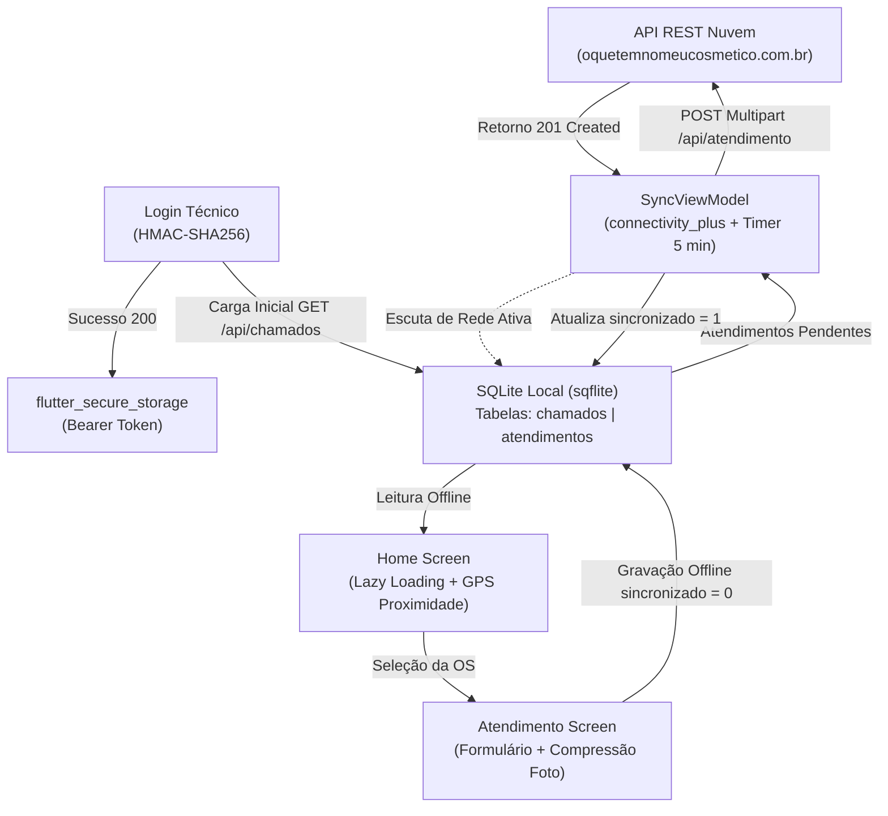

# 📡 SCTecCom — Gestão de Atendimentos em Campo (Offline-First)

<p align="center">
  
</p>

<p align="center">
  <strong>Aplicativo Android Profissional em Flutter para Gestão de Ordens de Serviço em Áreas de Sombra</strong><br>
  Desenvolvido sob a arquitetura <strong>MVVM (Model-View-ViewModel)</strong> com <strong>SQLite Local (sqflite)</strong>, <strong>Geolocalização (GPS)</strong>, <strong>Câmera com Compressão de Imagens</strong>, <strong>Autenticação Segura HMAC-SHA256</strong> e <strong>Sincronização em Nuvem (Multipart/Form-Data)</strong>.
</p>

---

## 🎯 1. O Problema e a Solução

### O Cenário Real

No setor de telecomunicações e provedores de internet (ISPs), técnicos de campo atendem chamados em constante deslocamento, frequentemente atuando em áreas de sombra de sinal, subsolos de edifícios, garagens ou zonas rurais onde a conectividade celular (4G/5G) é inexistente ou intermitente.

### A Solução Técnica: Abordagem Offline-First

O **SCTecCom** foi concebido para nunca travar ou perder dados por falta de rede:

- **100% Autônomo Offline:** O técnico consulta suas ordens de serviço ativas a partir de um banco **SQLite embarcado (sqflite)**, calcula distâncias até cada cliente via **GPS** do aparelho e preenche o parecer técnico com foto comprobatória mesmo em modo avião.
- **Sincronização Resiliente em Segundo Plano:** Utilizando a biblioteca **connectivity_plus** e um temporizador periódico de 5 minutos, o app detecta o restabelecimento da rede e realiza o upload atômico dos atendimentos pendentes via requisição HTTP `POST /api/atendimento` em formato `multipart/form-data`.
- **Segurança Corporativa:** As credenciais nunca transitam em texto puro: a senha do técnico é assinada localmente com **HMAC-SHA256** utilizando uma chave secreta antes do envio, e o Bearer Token é protegido no `flutter_secure_storage`.

---

## 🏗️ 2. Arquitetura da Aplicação (MVVM)

O projeto segue rigorosamente o padrão **MVVM (Model-View-ViewModel)** em camadas desacopladas e fortemente tipadas:

```
projeto_telecom/
├── README.md
├── pubspec.yaml
├── android/
├── assets/images/logo.png
├── lib/
│   ├── main.dart
│   ├── utils/
│   │   ├── constants.dart            # URLs, chave HMAC, categorias e limites
│   │   ├── crypto_helper.dart        # Assinatura HMAC-SHA256 (RF03)
│   │   ├── location_helper.dart      # Geolocalização e cálculo de distâncias em km (RF07)
│   │   └── image_helper.dart         # Captura, compressão e salvamento local (RF11)
│   ├── data/
│   │   ├── models/
│   │   │   ├── usuario_model.dart    # Model fortemente tipado com getters (RF01)
│   │   │   ├── chamado_model.dart    # Model de OS com SQLite/JSON e copyWith (RF01)
│   │   │   └── atendimento_model.dart# Model de Parecer Técnico e foto (RF01)
│   │   ├── datasources/
│   │   │   ├── local/
│   │   │   │   └── database_helper.dart # SQLite local com tabelas chamados/atendimentos (RF05)
│   │   │   └── remote/
│   │   │       ├── api_datasource.dart  # Cliente REST HTTP e upload multipart (RF03, RF04, RF13)
│   │   │       └── secure_storage_datasource.dart # Persistência de token criptografado (RF02, RF04)
│   │   └── repositories/
│   │       ├── auth_repository.dart        # Orquestrador de login e sessão
│   │       ├── chamado_repository.dart     # Carga inicial, banco local e ordenação GPS
│   │       └── atendimento_repository.dart # Gravação offline, multipart e busca histórica
│   ├── viewModel/
│   │   ├── auth_view_model.dart        # Estado de autenticação e auto-login
│   │   ├── chamados_view_model.dart    # Estado das ordens ativas e GPS
│   │   ├── atendimento_view_model.dart # Formulário, validação estrita e fotos
│   │   ├── historico_view_model.dart   # Histórico e filtro em tempo real
│   │   └── sync_view_model.dart        # Escuta connectivity_plus + timer de 5 min (RF13)
│   └── view/
│       ├── widgets/
│       │   └── network_status_bar.dart # Barra indicadora online/offline e pendências
│       ├── splash/
│       │   └── splash_screen.dart      # Verificação de sessão (RF02)
│       ├── login/
│       │   └── login_screen.dart       # Login com HMAC-SHA256 (RF03, RF04)
│       ├── home/
│       │   ├── home_screen.dart        # Listagem Lazy Loading (RF06, RF07, RF08)
│       │   └── widgets/
│       │       ├── chamado_card.dart   # Card com endereço e distância GPS
│       │       └── stats_grid.dart     # Métricas em GridView
│       ├── atendimento/
│       │   └── atendimento_screen.dart # Detalhes da OS e formulário estrito (RF09-RF12)
│       └── historico/
│           ├── historico_screen.dart   # Lista e busca em tempo real (RF14, RF15)
│           └── historico_detalhe_screen.dart # Parecer e renderização Image.file/network (RF16)
└── test/
    ├── utils/crypto_helper_test.dart
    ├── data/
    │   ├── models/models_test.dart
    │   ├── datasources/
    │   │   ├── database_helper_test.dart (SQLite in-memory)
    │   │   └── api_datasource_test.dart (Mock HTTP)
    │   └── repositories/
    │       ├── auth_repository_test.dart
    │       ├── chamado_repository_test.dart
    │       └── atendimento_repository_test.dart
    └── view/
        ├── login_screen_test.dart
        ├── atendimento_screen_test.dart
        └── home_screen_test.dart
```

### Diagrama de Fluxo e Sincronização



---

## 📋 3. Requisitos Funcionais Implementados

| Requisito | Descrição                                                                                                                                      |    Status    |
| :-------- | :--------------------------------------------------------------------------------------------------------------------------------------------- | :----------: |
| **RF01**  | Modelagem fortemente tipada (`UsuarioModel`, `ChamadoModel`, `AtendimentoModel`) com `fromJson`, `toJson`, `toMap`, `fromMap` e encapsulamento | ✅ Concluído |
| **RF02**  | Splash Screen com verificação automática de sessão e auto-login via token seguro                                                               | ✅ Concluído |
| **RF03**  | Autenticação segura com assinatura **HMAC-SHA256** da senha utilizando chave secreta da turma                                                  | ✅ Concluído |
| **RF04**  | Persistência do Bearer Token em `flutter_secure_storage` e carga inicial no SQLite                                                             | ✅ Concluído |
| **RF05**  | Banco de dados local SQLite (`DatabaseHelper`) com tabelas `chamados` e `atendimentos`                                                         | ✅ Concluído |
| **RF06**  | Home com listagem offline de chamados abertos utilizando `ListView.builder` (Lazy Loading)                                                     | ✅ Concluído |
| **RF07**  | Geolocalização (GPS via `geolocator`), cálculo de distância em km e ordenação crescente                                                        | ✅ Concluído |
| **RF08**  | Card de chamado com código, cliente, problema, endereço, distância e status offline                                                            | ✅ Concluído |
| **RF09**  | Tela de Atendimento com dados da OS, `DropdownButtonFormField`, multiline e anexo de foto                                                      | ✅ Concluído |
| **RF10**  | Validação estrita do formulário (`GlobalKey<FormState>`, categoria obrigatória, descrição ≥ 10 chars, SnackBar)                                | ✅ Concluído |
| **RF11**  | Captura de foto (câmera/galeria), compressão/redimensionamento até 5MB e persistência local                                                    | ✅ Concluído |
| **RF12**  | Conclusão do chamado offline: inserção com `sincronizado = 0` e atualização do status para `atendido`                                          | ✅ Concluído |
| **RF13**  | Sincronização em nuvem via `connectivity_plus` e rotina periódica a cada 5 minutos (upload multipart)                                          | ✅ Concluído |
| **RF14**  | Histórico de atendimentos com badge visual (`Sincronizado` vs `Pendente de Envio`) e `ListView.builder`                                        | ✅ Concluído |
| **RF15**  | Barra de pesquisa com filtro em tempo real por ID do chamado ou código do cliente                                                              | ✅ Concluído |
| **RF16**  | Visualização detalhada com renderização condicional de foto (`Image.file` local ou `Image.network` remoto)                                     | ✅ Concluído |

---

## 🛠️ 4. Requisitos Técnicos e Boas Práticas

| Conteúdo Técnico                     | Demonstração no Código                                                                                                  |
| :----------------------------------- | :---------------------------------------------------------------------------------------------------------------------- |
| **Lógica de programação**            | Cálculo de distâncias geográficas Haversine/GPS em `LocationHelper`, compressão e filtros                               |
| **Dart & Sintaxe Básica**            | `main.dart`, variáveis tipadas, funções síncronas e assíncronas                                                         |
| **Tipos de dados**                   | `String`, `int`, `double`, `bool`, `List`, `Map<String, dynamic>`                                                       |
| **If-else e Operador Ternário**      | Validações de formulário, formatação de distâncias (`distanciaKm < 1.0 ? ... : ...`) e badges de status                 |
| **Operadores Lógicos e Matemáticos** | `&&`, `\|\|`, `!`, cálculo `distanciaMetros / 1000.0` e `reduce`                                                        |
| **Estruturas de Iteração**           | `for (final chamado in chamados)`, `map`, `where`                                                                       |
| **Métodos Avançados de Coleções**    | `map`, `where`, `reduce` (encontrar chamado mais próximo), `every` (validação de coordenadas)                           |
| **Programação Orientada a Objetos**  | Classes de modelos, datasources, repositories e viewModels                                                              |
| **Encapsulamento**                   | Atributos privados (`_id`, `_codigoCliente`, `_storage`) com getters públicos                                           |
| **Polimorfismo**                     | Sobrescrita de métodos com `@override` (`toString`, `==`, `hashCode`, `build`, `dispose`)                               |
| **ListView & GridView**              | `ListView.builder` para lazy loading e `GridView.builder` no componente `StatsGrid`                                     |
| **Image.asset**                      | Logotipo do aplicativo renderizado a partir de `assets/images/logo.png`                                                 |
| **Navegação Nomeada**                | Rotas centralizadas no `MaterialApp` (`/splash`, `/login`, `/home`, `/atendimento`, `/historico`, `/historico_detalhe`) |
| **Itens de Formulário & Validators** | `DropdownButtonFormField`, `TextFormField` multilinhas, `SwitchListTile`, `Slider` e `GlobalKey<FormState>`             |

---

## 🧪 5. Testes Unitários e de Widget (RNF01)

O projeto conta com **28 testes automatizados** passando com 100% de sucesso:

```bash
flutter test
```

### Cobertura de Testes

1. **Datasources & Utilitários:**
   - `test/utils/crypto_helper_test.dart`: Validação da assinatura HMAC-SHA256 de 64 caracteres e compatibilidade com a chave da turma.
   - `test/data/datasources/database_helper_test.dart`: Teste real de persistência SQLite em memória (`sqflite_common_ffi`), inserção de ordens, isolamento offline e alteração atômica de status.
   - `test/data/datasources/api_datasource_test.dart`: Teste com Mock HTTP para respostas `200 OK`, `401 Unauthorized` e upload multipart.
2. **Repositories:**
   - `test/data/repositories/auth_repository_test.dart`: Fluxo de login e orquestração com storage seguro.
   - `test/data/repositories/chamado_repository_test.dart`: Ordenação por proximidade GPS e métodos avançados (`where`, `every`, `reduce`).
   - `test/data/repositories/atendimento_repository_test.dart`: Gravação offline, upload multipart e filtro em tempo real.
3. **Widget Tests:**
   - `test/view/login_screen_test.dart`: Renderização dos campos de login e disparo de validações.
   - `test/view/atendimento_screen_test.dart`: Renderização do cabeçalho da OS, dropdown técnico, multiline e validação de 10 caracteres.
   - `test/view/home_screen_test.dart`: Renderização de métricas em `GridView` (`StatsGrid`) e cards com distância GPS (`ChamadoCard`).

---

## 🚀 6. Como Executar o Projeto

### Pré-requisitos

- Flutter SDK 3.22+ instalado e configurado no PATH
- Android Studio / Android SDK instalado para execução no emulador ou dispositivo físico
- Git instalado

### Passo a Passo

1. **Clonar o Repositório:**

   ```bash
   git clone <URL_DO_REPOSITORIO>
   cd scteccom_app
   ```

2. **Instalar as Dependências:**

   ```bash
   flutter pub get
   ```

3. **Verificar Análise Estática:**

   ```bash
   dart analyze
   ```

   _(Resultado esperado: `No issues found!`)_

4. **Executar a Suíte de Testes:**

   ```bash
   flutter test
   ```

5. **Executar no Emulador ou Aparelho Android:**
   ```bash
   flutter run
   ```

---

## 💡 7. Credenciais e Configuração da API

- **Swagger Interativo:** `https://oquetemnomeucosmetico.com.br/docs/`
- **URL Base da API:** `https://oquetemnomeucosmetico.com.br/api`
- **Chave Secreta HMAC-SHA256 da Turma:** `ISP_TECH_SENAI_2026_xK9#mQ2$vL8!zP4`
- **Credenciais de Acesso:** Cada aluno utiliza seu e-mail institucional e senha fornecidos no ambiente de ensino. O aplicativo calcula a assinatura HMAC-SHA256 antes da transmissão.

---

## 🔮 8. Melhorias Futuras

1. **Mapas Interativos (OpenStreetMap / Google Maps):** Traçar rotas de deslocamento ponto a ponto a partir da geolocalização do técnico até o endereço da OS.
2. **Assinatura Digital do Cliente:** Coleta da assinatura na tela via touchscreen na finalização da visita técnica.
3. **Leitura de Código de Barras / QR Code:** Leitura do número de série (MAC / PON) da ONU instalada via câmera para agilizar o cadastro de equipamentos.
4. **Push Notifications (FCM):** Notificação instantânea ao técnico quando um novo chamado de emergência for atribuído à sua rota.

---

<p align="center">
  <strong>SENAI Santa Catarina — Curso de Desenvolvimento de Aplicativos Android com Flutter</strong><br>
  Professor: Rafael Aguiar
</p>
